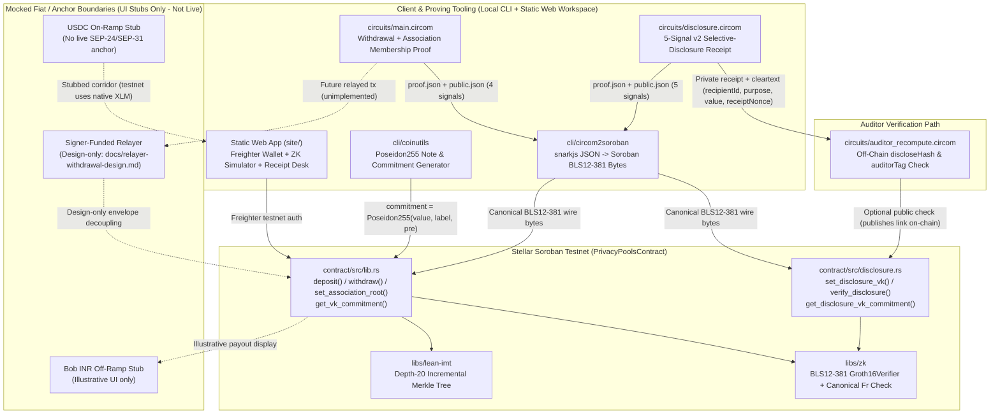
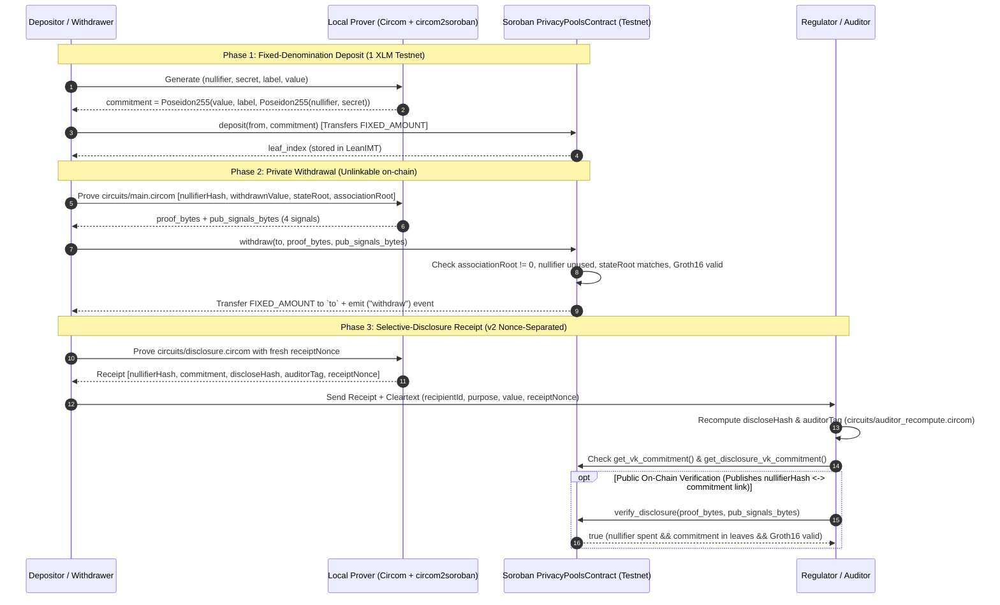

# Setu Protocol & Application Architecture

**Status: prototype.** This document visualizes the end-to-end architecture of Setu on the Stellar **testnet**, explicitly separating **live implemented components (solid lines)** from **mocked UI stubs and design-only components (dashed lines)**. Read alongside [docs/privacy-compliance-limitations.md](./privacy-compliance-limitations.md).

---

## 1. System Topology (Live Testnet vs Stubbed Boundaries)

- **Solid arrows (`-->`)** represent implemented code paths tested in `contract/`, `circuits/`, `libs/zk/`, `cli/`, and `site/`.
- **Dashed arrows (`-.->`)** represent **mocked product-story stubs** (USDC on-ramp, INR off-ramp) or **design-only specifications** (signer-funded relayer).

---

## 2. Deposit, Withdrawal & Selective-Disclosure Sequence

---

## 3. Architectural Invariants & Prototype Limits

1. **Cross-Layer Signal Ordering:** `circuits/main.circom` (4 signals) and `circuits/disclosure.circom` (5 signals) must match `cli/circom2soroban`, `libs/zk`, and `contract/src/` byte-for-byte (pinned by `libs/zk/testdata/public_signals/`).
2. **Honest Boundary Separation:** The Soroban contract and BLS12-381 Groth16 verifier execute real cryptographic verification on Stellar testnet, whereas fiat/USDC/INR anchor rails in `site/` are mock UI stubs and the Groth16 ceremony is a local single-contributor setup (`not production-secure`).
