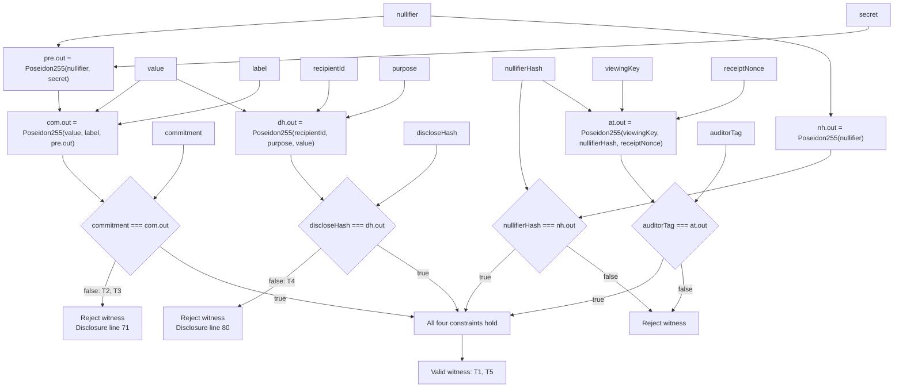
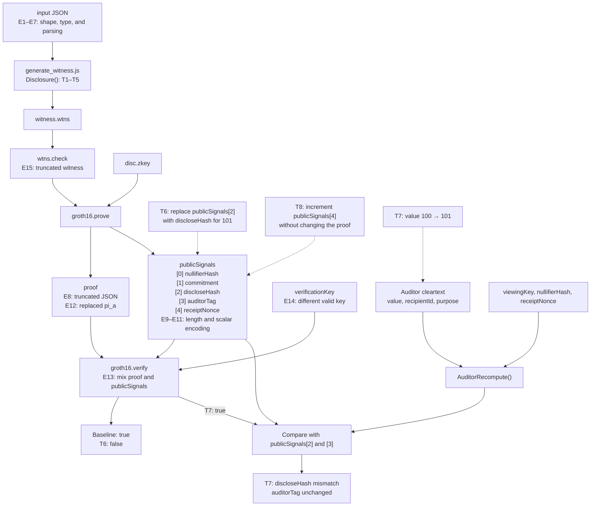

# Disclosure Security Test Report

## Execution summary

| Item | Recorded value |
| --- | --- |
| Primary issue | #23 — reject a changed disclosed amount |
| Branch | `test/23-tampered-disclosed-value` |
| Base revision | `733e2da71793d7c63bfb7369e48c569e29cde02d`, with local test additions |
| Execution date | 2026-10-21 UTC |
| Receipt format | v2: five public signals, including `receiptNonce` (upstream PR #102) |
| Environment | Windows; Node 24.13.1; Circom 2.2.2; snarkjs 0.7.6; circomlib 2.0.5; Rust 1.90.0 |
| Network dependency | No testnet, wallet, or Stellar CLI required |
| Remote CI | Not executed when this local report was recorded |

| Suite | Passed | Failed | Exit code |
| --- | ---: | ---: | ---: |
| Disclosure: T1–T8, E1–E15 | 23 | 0 | 0 |
| Process failure handling | 6 | 0 | 0 |

The disclosure and process cases meet their specified outcomes. A negative case is marked PASS when the expected rejection occurs; this does not mean the tampered input was accepted.

## Scope and fixtures

Verify that the same `value` is bound to both `commitment` and `discloseHash`, then exercise malformed inputs, mismatched proof artifacts, and process failures.

The [baseline fixture](../circuits/test/fixtures/disclosure/valid.json) uses `value = 100`, `label = 42`, `nullifier = 12345`, `secret = 67890`, `recipientId = 11111`, `purpose = 7`, `viewingKey = 99999`, and public `receiptNonce = 31337`. Its four public hashes are derived with `disclosure_witness.circom` and checked against the fixture on each run; the nonce is carried through as the fifth public signal, not read as a fifth helper output. The [tampered fixture](../circuits/test/fixtures/disclosure/tampered-value.json) changes only `value` to 101. Hash recomputation in subsequent amount cases preserves all other inputs, including the nonce. The fixtures contain public development secrets.

Implementation: [circuit](../circuits/disclosure.circom), [test runner](../scripts/test-disclosure.cjs), [process tests](../scripts/test-disclosure-process.test.cjs).

## Circuit and test locations

### Disclosure constraints

`Disclosure()` receives seven private inputs, four supplied public hashes, and public `receiptNonce`. It derives `pre.out` from `nullifier` and `secret`, then combines it with `value` and `label` to reconstruct the commitment. A separate calculation combines `recipientId`, `purpose`, and the same `value` to reconstruct the disclosure hash. Both reconstructed hashes must equal their supplied public inputs. The remaining constraints check `nullifierHash` and bind `auditorTag` to `viewingKey`, that nullifier hash, and `receiptNonce`.



### Generation and verification



Witness generation evaluates the circuit and produces its inputs and intermediate values. `wtns.check` checks this witness against the compiled R1CS constraint system before proof generation. The prover then produces a `proof` and the ordered `publicSignals`; the verifier checks them using `verificationKey`. The auditor's cleartext follows a separate recomputation and comparison path in the test harness. Dashed arrows identify test mutations.

## Test results

### Amount binding

| ID | Change from baseline | Expected outcome | Actual outcome | Status |
| --- | --- | --- | --- | --- |
| T1 | None | Witness satisfies R1CS | Witness generated; R1CS valid | PASS |
| T2 | `value: 100 → 101` | Reject witness | `commitment === com.out` assertion, line 71 | PASS |
| T3 | `value → 101`; recompute `discloseHash` | Reject original commitment binding | Same commitment assertion, line 71 | PASS |
| T4 | `value → 101`; recompute `commitment` | Reject original disclosure binding | `discloseHash === dh.out` assertion, line 80 | PASS |
| T5 | `value → 101`; recompute both hashes | Accept consistent new statement | Witness generated; R1CS valid | PASS |
| T6 | Keep `proof`; replace only `publicSignals[2]` with the hash for 101 | Reject proof | Verifier reports `Invalid proof` | PASS |
| T7 | Keep proof/public signals; change auditor cleartext `value → 101` | Proof valid; cleartext comparison fails | Original cleartext matches; changed `discloseHash` mismatches; `auditorTag` matches | PASS |
| T8 | Keep proof; change only public `receiptNonce: 31337 → 31338` | Reject proof | Verifier reports `Invalid proof` | PASS |

**T1 — Valid baseline.** This establishes that the fixture, witness calculator, and compiled constraints work together before rejection cases run. A suite that rejects every input would fail this control.

**T2 — Amount-only tampering.** The reconstructed commitment changes while the supplied commitment still describes the original note. The resulting assertion confirms that this mismatch is detected. Because execution stops at that assertion, T2 alone cannot establish that the disclosure-hash constraint is also enforced.

**T3 and T4 — Independent binding checks.** T3 makes the disclosure hash consistent with the changed amount, leaving only the original commitment to prevent acceptance. T4 makes the commitment consistent instead, allowing execution to reach the unchanged disclosure hash. Their separate failures show that updating either hash alone cannot bypass the other binding.

**T5 — Consistent-statement control.** Updating both hashes produces a different but internally consistent statement, which the circuit should accept. This rules out an implementation that simply rejects amount 101. It establishes circuit consistency, not that the replacement commitment exists in the pool's deposited state.

**T6 — Proof-to-statement binding.** The runner first generates and verifies a genuine amount-100 proof. It then changes one public signal to a valid in-field hash without altering the proof or key. Rejection therefore exercises the binding between a proof and its public statement, rather than relying on malformed scalar encoding or witness-generation failure.

**T7 — External cleartext verification.** The verifier still receives the original proof and public signals, so its successful result is expected. The altered amount is detected when the auditor recomputes `discloseHash` from the separate cleartext and compares it with the proven hash. `auditorTag` remains equal because its inputs, `viewingKey`, `nullifierHash`, and `receiptNonce`, have not changed. This case verifies the required auditor comparison and identifies what proof verification alone does not check.

**T8 — v2 nonce binding.** The same genuine amount-100 proof is verified with only its fifth public signal changed to another canonical nonce. Rejection checks proof-to-statement binding for the new v2 field. It does not establish nonce freshness across receipts.

T1 and T5 check witnesses and R1CS. The runner separately generates the proof used by T6/T7/T8 and the amount-101 proof used by E13. Assertion line numbers refer to the recorded source revision.

An additional local sensitivity check compiled isolated copies of the v2 circuit with either `commitment === com.out` or `discloseHash === dh.out` removed. The previously rejected T3 or T4 input then generated a valid witness satisfying that modified R1CS. This confirms that these negative cases detect removal of their respective amount-binding constraint; the repository circuit was not modified.

### Malformed inputs and mismatched artifacts

Each case requires a nonzero CLI exit and its specified diagnostic. All cases below returned exit code 1 and passed that assertion.

| ID | Mutation | Actual diagnostic |
| --- | --- | --- |
| E1 | Delete `value` | `Not all inputs have been set` |
| E2 | Add `unknownInput` | `Signal unknownInput not found` |
| E3 | `value → ["100", "101"]` | `Too many values for input signal value` |
| E4 | `value → "100x"` | `SyntaxError: Cannot convert 100x to a BigInt` |
| E5 | `value → "100.5"` | `SyntaxError: Cannot convert 100.5 to a BigInt` |
| E6 | `value → null` | `TypeError: Cannot convert undefined or null to object` |
| E7 | Truncate witness-input JSON | `SyntaxError: Unexpected end of JSON input` |
| E8 | Truncate proof JSON | `SyntaxError: Unexpected end of JSON input` |
| E9 | Remove fifth public signal (`receiptNonce`) | `Invalid proof` |
| E10 | Append sixth public signal `"0"` | `TypeError: Cannot read properties of undefined (reading '0')` |
| E11 | `publicSignals[2] → publicSignals[2] + r` | `Public inputs are not valid.` |
| E12 | `proof.pi_a → ["0", "0", "1"]` | `Invalid proof` |
| E13 | Amount-100 `proof` with amount-101 `publicSignals` | `Invalid proof`; original pairs independently verified first |
| E14 | Another well-formed `verificationKey` for the same circuit shape | `Invalid proof` |
| E15 | Truncate valid witness binary to 16 bytes | `SyntaxError: Cannot convert 0x to a BigInt` |

**E1–E3 — Input structure.** These cases check that an absent scalar, an unrecognized field, and an array supplied for a scalar cannot silently become a different witness input. Each failure is reported by input-loading code, rather than by a failed amount-binding equality.

**E4–E6 — Value parsing.** These cases check that nonnumeric text, a fractional amount, and `null` do not become usable field inputs through coercion. The recorded `SyntaxError` and `TypeError` results prevent witness generation, but they also show that these paths throw exceptions rather than returning a structured validation error.

**E7, E8, and E15 — Incomplete files.** Truncation is applied at three distinct boundaries: witness-input JSON, proof JSON, and the binary witness. Each must fail at its own reader. These cases check artifact integrity before mathematical validation; they do not demonstrate a failed pairing equation or an unsatisfied R1CS constraint.

**E9–E11 — Public-signal interface.** E9 checks an incomplete statement, E10 an oversized statement, and E11 a scalar outside the canonical field range. Adding the scalar-field modulus `r` in E11 preserves the mathematical residue but changes the supplied encoding, which must be rejected. E10 instead raises a `TypeError`, exposing a different failure path from the normal `Invalid proof` result in E9.

**E12–E14 — Proof artifact integrity.** E12 checks rejection after replacing proof coordinates. E13 combines parts of two independently verified receipts to test whether a valid proof can be reassigned to another statement. E14 replaces the verification key with a different well-formed key for the same circuit shape. Together they exercise the relationship among proof, statement, and key. E12's diagnostic establishes rejection without locating a more specific internal check.

### Process failure handling

| Case | Actual outcome | Status |
| --- | --- | --- |
| Successful child command | Exit 0; stdout retained | PASS |
| Unexpected child failure | Exit 1; helper rejects it | PASS |
| Explicitly allowed rejection | Exit 1 retained as a rejection | PASS |
| Missing executable | `ENOENT`; not accepted as expected rejection | PASS |
| Child exceeds 500 ms timeout | `ETIMEDOUT`; child killed; helper rejects it | PASS |
| Real runner without Circom on `PATH` | Failed report saved; zero tests executed; no verified-proof flag | PASS |

These cases test the command helper's distinction between an expected rejection and a failure to execute the test. Both can produce an unsuccessful process result, so exit status alone is insufficient. The synthetic child commands exercise output capture and rejection bookkeeping; missing-executable and timeout cases must remain infrastructure errors even when rejection is allowed. The missing-Circom case runs the actual test runner and verifies that setup failure is reported without claiming any completed proof tests.

## Amount representation limits

Two additional observations are recorded outside the pass/fail totals:

| Mutation | Hashes supplied | Actual outcome |
| --- | --- | --- |
| `value: 100 → 100 + r` | Original amount-100 hashes | Witness accepted; R1CS valid |
| `value: r - 1 → -1` | Hashes computed for `r - 1` | Witness accepted; R1CS valid |

```text
r = 52435875175126190479447740508185965837690552500527637822603658699938581184513
```

The witness calculator reduces integers modulo the scalar-field modulus `r`, making `100 + r` equivalent to `100` and `-1` equivalent to `r - 1` inside the circuit. The unchanged hashes therefore remain consistent in these observations. This separates binding to a field element from validating a monetary amount's decimal representation and permitted range. The disclosure circuit has no business amount-range constraint.

## Reproduction

From the repository root, with Node.js and Circom on `PATH`:

```bash
npm ci --prefix circuits/test
npm run test:runner --prefix circuits/test
npm run test:disclosure --prefix circuits/test
```

Node dependencies are pinned by `circuits/test/package-lock.json`. Disclosure runs compile fresh circuits, use separate witness processes, and create fresh development keys and proofs. Input/hash values are deterministic; setup and proof bytes use randomness.

## Evidence

| Suite | Retained report and output |
| --- | --- |
| Disclosure | `circuits/build_disc/disclosure-tests/2026-10-21T22-41-48-974Z-YqTWf4/report.json` |
| Process failures | Per-command JSON records under `circuits/build_disc/process-tests/run-OoiVRk/` |
| Constraint sensitivity | `circuits/build_disc/disclosure-mutations/run-NpEp3S/report.json` |

The timestamps in evidence-directory names are UTC; the execution date above uses Asia/Shanghai. The upstream `zk` suite was also rerun with `cargo +1.90.0 test --offline --locked -p zk`: 17 passed, 0 failed, exit 0.

These are local paths from the recorded run, not files published in the repository. Evidence is gitignored and is not included in a fresh clone. Each new disclosure run prints its own evidence directory; the process suite prints its command-record directory. The report includes source hashes, tool versions, command arguments, exit codes, stdout/stderr, and per-case observations. Compiled artifacts, inputs, witnesses, keys, and proofs remain beside it. On GitHub Actions, open the workflow run and download the `disclosure-security-results` artifact; the disclosure CI job uploads it even on failure.

## Coverage limits

- No on-chain deposited-commitment or spent-nullifier checks are exercised.
- `recipientId` and `purpose` remain prover-asserted context, not authenticated deposit-time facts.
- Issue #28 remains open: this suite does not check Circom/Rust Poseidon parity.
- T8 checks nonce binding, not freshness: v2 still permits a prover to reuse a nonce and reproduce the same auditor tag for the same viewing key and nullifier hash.
- This prototype has not undergone a cryptographic audit. Its single-contributor Groth16 setup uses public test entropy and is unsuitable for production.
